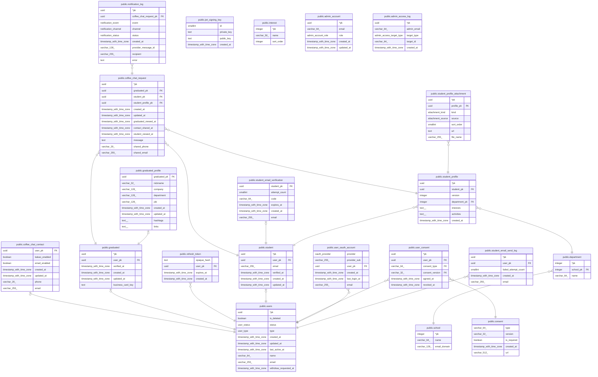

# cheers

## Description

[tbls](https://github.com/k1LoW/tbls)로 생성한 문서입니다. 직접 고치지 말고 `.tbls.yml`이나 `drizzle/schema/`를 고친 뒤 `bun run db:docs`로 다시 생성하세요.  
  
FK는 모두 `ON DELETE NO ACTION`입니다. 부모 행을 지우기 전에 백엔드가 같은 트랜잭션에서 자식 행을 먼저 지웁니다.  
  
서비스 로직으로 지키는 규칙:  
  
- `users.type`과 `student` / `graduated` 행이 일치함. 유형은 가입 중에만 바꿀 수 있음  
- `pending` 유저는 가입 절차 API만 호출할 수 있음  
- 가입 후 · 마지막 활동 후 24시간이 지난 `pending` 유저는 스케줄러가 삭제함  
- 필수 약관은 철회할 수 없음  
- 재학생 학과는 인증한 학교 이메일 도메인의 학교 소속이어야 함  
- 재학생의 `coffee_chat_contact`는 두 플래그 중 하나 이상이 true여야 함 (현업자는 둘 다 false 가능)  
- `student_profile`과 첨부는 프로필 수정 때 insert만 함. 지우는 경우는 가입 중 유형 변경과 탈퇴 처리뿐임  
- `graduated.verified_at`이 null인 현업자는 `active`여도 재학생에게 보이지 않고 커피챗 요청을 받거나 처리할 수 없음 (어드민의 명함 인증 취소)  

## Tables

| Name | Columns | Comment | Type |
| ---- | ------- | ------- | ---- |
| [public.coffee_chat_contact](public.coffee_chat_contact.md) | 7 | 커피챗 연락수단 (재학생 · 현업자 공통). 희망하지 않음 = 두 플래그 모두 false | BASE TABLE |
| [public.coffee_chat_request](public.coffee_chat_request.md) | 12 | 커피챗 요청. 같은 현업자에게 중복 요청 가능. 진행 단계(현업자 확인 → 연락처 공유 → 재학생 확인)는 처음 했을 때 시각만 기록 | BASE TABLE |
| [public.consent](public.consent.md) | 5 | 약관 버전 기준 데이터. 새 버전은 행을 수정하지 말고 어드민에서 새로 등록 (POST /api/manager/v1/consent) | BASE TABLE |
| [public.department](public.department.md) | 3 | 학과 기준 데이터. 학과명이 바뀌면 같은 행의 name만 수정 (버전 관리 안 함) | BASE TABLE |
| [public.graduated_profile](public.graduated_profile.md) | 9 | 현업자 추가 정보. 알림 수단 · 공유할 연락처는 coffee_chat_contact | BASE TABLE |
| [public.graduated](public.graduated.md) | 6 | 현업자 | BASE TABLE |
| [public.notification_log](public.notification_log.md) | 9 | 이메일 · 카카오 알림톡 전송 로그 (channel로 구분). insert만 함, 재시도도 새 행 | BASE TABLE |
| [public.refresh_token](public.refresh_token.md) | 4 | 리프레시 토큰 | BASE TABLE |
| [public.school](public.school.md) | 3 | 학교 기준 데이터 (seed로 pk를 고정해서 넣음) | BASE TABLE |
| [public.student_email_verification](public.student_email_verification.md) | 6 | 진행 중인 학교 이메일 인증. 학생당 1개, 재요청 시 upsert, 인증 성공 시 행 삭제 | BASE TABLE |
| [public.student_profile_attachment](public.student_profile_attachment.md) | 7 | CV · 포트폴리오. 이전 버전이 참조하므로 프로필 수정 때는 S3 파일을 지우지 않음. 행과 파일은 탈퇴 만료 처리 때 지움 | BASE TABLE |
| [public.student_profile](public.student_profile.md) | 7 | 재학생 추가 정보 버전. 수정하면 새 버전, 현재 값 = 가장 큰 version | BASE TABLE |
| [public.student](public.student.md) | 6 | 재학생 | BASE TABLE |
| [public.user_consent](public.user_consent.md) | 6 | 동의 이력. 철회하면 revoked_at 기록, 재동의는 새 행 | BASE TABLE |
| [public.user_oauth_account](public.user_oauth_account.md) | 6 | 유저에 연동된 OAuth 계정 | BASE TABLE |
| [public.users](public.users.md) | 10 | 모든 유저의 공통 정보. 유형별 정보는 student / graduated | BASE TABLE |
| [public.jwt_signing_key](public.jwt_signing_key.md) | 4 | 서버 전체에서 하나인 JWT 서명 키. replica가 각자 다른 키를 넣지 못하도록 행을 1개로 제한 | BASE TABLE |
| [public.student_email_send_log](public.student_email_send_log.md) | 5 | 학교 이메일 인증번호 전송 기록 (전송마다 새 행). 최근 24시간 전송 상한 · 누적 실패 상한에 씀. 유형을 바꾸면 student 행이 새로 만들어져 횟수가 초기화되므로 user_pk 기준 | BASE TABLE |
| [public.interest](public.interest.md) | 3 | 재학생이 고를 수 있는 고정 관심 분야 기준 데이터. 목록 수정은 어드민에서 하며, 서버는 기동 때 한 번 읽어 메모리에 둠 | BASE TABLE |
| [public.admin_account](public.admin_account.md) | 5 | 어드민 페이지에 로그인할 수 있는 이메일 목록. 앱 유저(users)와 관계없음 | BASE TABLE |
| [public.admin_access_log](public.admin_access_log.md) | 5 | 어드민의 개인정보 열람 기록. insert만 함. 탈퇴 삭제(purge)를 막지 않도록 다른 테이블로 FK를 걸지 않음 | BASE TABLE |

## Enums

| Name | Values |
| ---- | ------- |
| public.admin_access_target_type | business_card |
| public.admin_account_role | admin, superadmin |
| public.attachment_kind | cv, portfolio |
| public.attachment_source | file, link |
| public.notification_channel | email, kakao_alimtalk |
| public.notification_event | coffee_chat_requested, contact_shared |
| public.notification_status | failed, sent |
| public.oauth_provider | apple, google, naver |
| public.user_status | active, pending |
| public.user_type | graduated, student |

## Relations

---

> Generated by [tbls](https://github.com/k1LoW/tbls)
