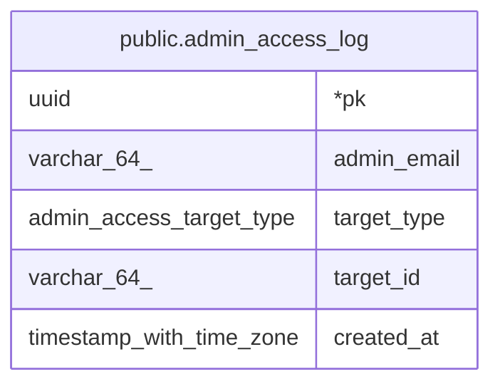

# public.admin_access_log

## Description

어드민의 개인정보 열람 기록. insert만 함. 탈퇴 삭제(purge)를 막지 않도록 다른 테이블로 FK를 걸지 않음

## Columns

| Name | Type | Default | Nullable | Children | Parents | Comment |
| ---- | ---- | ------- | -------- | -------- | ------- | ------- |
| pk | uuid |  | false |  |  |  |
| admin_email | varchar(64) |  | false |  |  | 열람 시점의 어드민 이메일. 어드민 계정을 지워도 남음 |
| target_type | admin_access_target_type |  | false |  |  | 열람한 개인정보 종류 |
| target_id | varchar(64) |  | false |  |  | target_type = business_card: graduated.pk |
| created_at | timestamp with time zone | now() | false |  |  |  |

## Constraints

| Name | Type | Definition |
| ---- | ---- | ---------- |
| admin_access_log_pkey | PRIMARY KEY | PRIMARY KEY (pk) |

## Indexes

| Name | Definition |
| ---- | ---------- |
| admin_access_log_pkey | CREATE UNIQUE INDEX admin_access_log_pkey ON public.admin_access_log USING btree (pk) |

## Relations

---

> Generated by [tbls](https://github.com/k1LoW/tbls)
