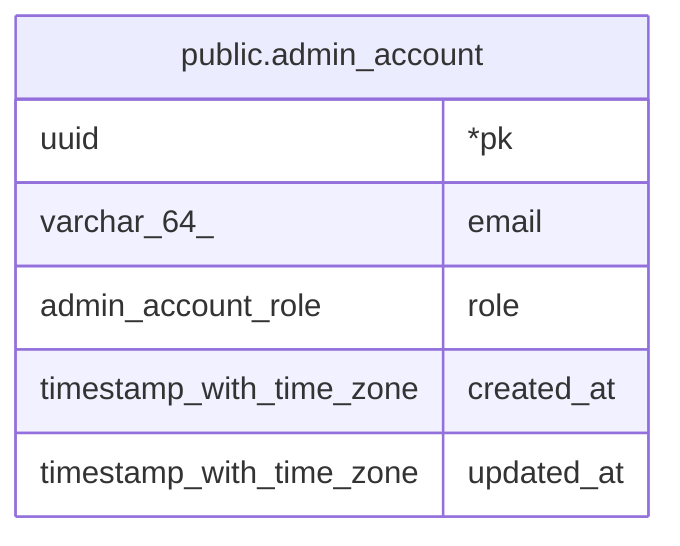

# public.admin_account

## Description

어드민 페이지에 로그인할 수 있는 이메일 목록. 앱 유저(users)와 관계없음

## Columns

| Name | Type | Default | Nullable | Children | Parents | Comment |
| ---- | ---- | ------- | -------- | -------- | ------- | ------- |
| pk | uuid |  | false |  |  |  |
| email | varchar(64) |  | false |  |  | 소문자로 저장. IdP가 확인해 준 이메일과 비교 |
| role | admin_account_role | 'admin'::admin_account_role | false |  |  | superadmin만 어드민 계정을 등록 · 변경 · 삭제할 수 있음 |
| created_at | timestamp with time zone | now() | false |  |  |  |
| updated_at | timestamp with time zone | now() | false |  |  |  |

## Constraints

| Name | Type | Definition |
| ---- | ---- | ---------- |
| admin_account_pkey | PRIMARY KEY | PRIMARY KEY (pk) |
| admin_account_email_unique | UNIQUE | UNIQUE (email) |

## Indexes

| Name | Definition |
| ---- | ---------- |
| admin_account_pkey | CREATE UNIQUE INDEX admin_account_pkey ON public.admin_account USING btree (pk) |
| admin_account_email_unique | CREATE UNIQUE INDEX admin_account_email_unique ON public.admin_account USING btree (email) |

## Relations

---

> Generated by [tbls](https://github.com/k1LoW/tbls)
