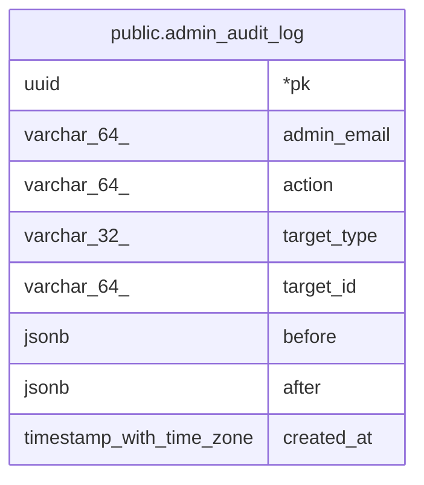

# public.admin_audit_log

## Description

어드민의 데이터 변경 기록 (변경 전 · 후 값). 변경과 같은 트랜잭션에서 insert만 함. 대상이 지워져도 남도록 다른 테이블로 FK를 걸지 않음

## Columns

| Name | Type | Default | Nullable | Children | Parents | Comment |
| ---- | ---- | ------- | -------- | -------- | ------- | ------- |
| pk | uuid |  | false |  |  |  |
| admin_email | varchar(64) |  | false |  |  | 요청 시점의 어드민 이메일. 어드민 계정을 지워도 남음 |
| action | varchar(64) |  | false |  |  | "\<target_type\>.\<verb\>" (예: admin_account.role_update). 목록은 drizzle/schema/admin-audit-log.ts의 ADMIN_AUDIT_ACTIONS |
| target_type | varchar(32) |  | false |  |  | 변경된 엔티티 종류 (admin_account, interest, company 등) |
| target_id | varchar(64) |  | true |  |  | 대상 엔티티 pk (문자열). 일괄 작업은 null |
| before | jsonb |  | true |  |  | 변경 전 값 (JSON). 생성이면 null |
| after | jsonb |  | true |  |  | 변경 후 값 (JSON). 삭제면 null |
| created_at | timestamp with time zone | now() | false |  |  |  |

## Constraints

| Name | Type | Definition |
| ---- | ---- | ---------- |
| admin_audit_log_pkey | PRIMARY KEY | PRIMARY KEY (pk) |

## Indexes

| Name | Definition |
| ---- | ---------- |
| admin_audit_log_pkey | CREATE UNIQUE INDEX admin_audit_log_pkey ON public.admin_audit_log USING btree (pk) |

## Relations

---

> Generated by [tbls](https://github.com/k1LoW/tbls)
