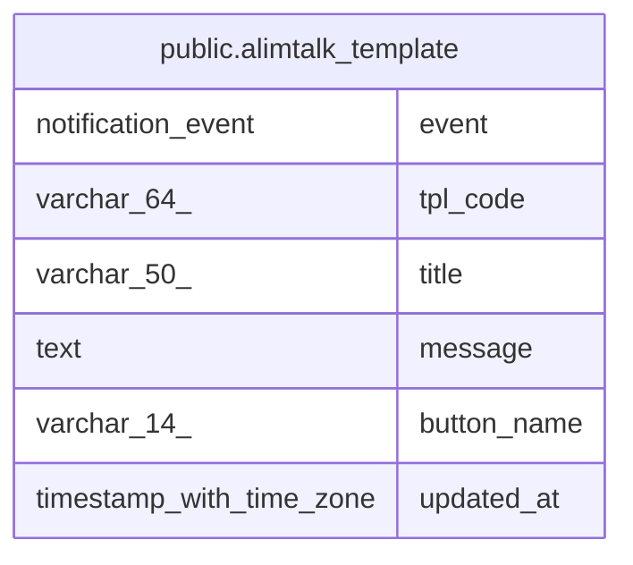

# public.alimtalk_template

## Columns

| Name | Type | Default | Nullable | Children | Parents | Comment |
| ---- | ---- | ------- | -------- | -------- | ------- | ------- |
| event | notification_event |  | false |  |  |  |
| tpl_code | varchar(64) | ''::character varying | false |  |  |  |
| title | varchar(50) |  | false |  |  |  |
| message | text |  | false |  |  |  |
| button_name | varchar(14) |  | false |  |  |  |
| updated_at | timestamp with time zone | now() | false |  |  |  |

## Constraints

| Name | Type | Definition |
| ---- | ---- | ---------- |
| alimtalk_template_pkey | PRIMARY KEY | PRIMARY KEY (event) |

## Indexes

| Name | Definition |
| ---- | ---------- |
| alimtalk_template_pkey | CREATE UNIQUE INDEX alimtalk_template_pkey ON public.alimtalk_template USING btree (event) |

## Relations

---

> Generated by [tbls](https://github.com/k1LoW/tbls)
