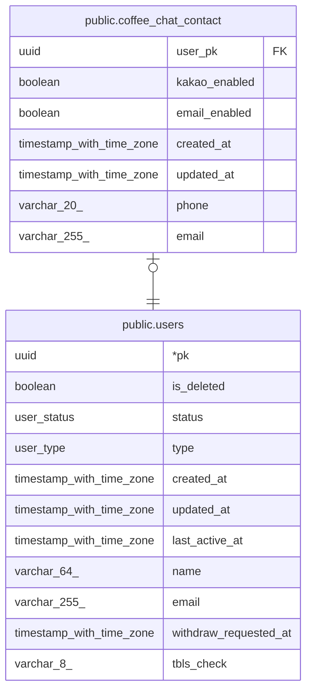

# public.coffee_chat_contact

## Description

커피챗 연락수단 (재학생 · 현업자 공통). 희망하지 않음 = 두 플래그 모두 false

## Columns

| Name | Type | Default | Nullable | Children | Parents | Comment |
| ---- | ---- | ------- | -------- | -------- | ------- | ------- |
| user_pk | uuid |  | false |  | [public.users](public.users.md) |  |
| kakao_enabled | boolean |  | false |  |  |  |
| email_enabled | boolean |  | false |  |  |  |
| created_at | timestamp with time zone | now() | false |  |  |  |
| updated_at | timestamp with time zone | now() | false |  |  |  |
| phone | varchar(20) |  | true |  |  | 하이픈 없이 정규화해서 저장. 카카오 알림톡을 끄면 null로 지움 |
| email | varchar(255) |  | true |  |  | 이메일 연락을 끄면 null로 지움 |

## Constraints

| Name | Type | Definition |
| ---- | ---- | ---------- |
| coffee_chat_contact_email_check | CHECK | CHECK (((NOT email_enabled) OR (email IS NOT NULL))) |
| coffee_chat_contact_kakao_phone_check | CHECK | CHECK (((NOT kakao_enabled) OR (phone IS NOT NULL))) |
| coffee_chat_contact_pkey | PRIMARY KEY | PRIMARY KEY (user_pk) |
| coffee_chat_contact_user_pk_users_pk_fk | FOREIGN KEY | FOREIGN KEY (user_pk) REFERENCES users(pk) |

## Indexes

| Name | Definition |
| ---- | ---------- |
| coffee_chat_contact_pkey | CREATE UNIQUE INDEX coffee_chat_contact_pkey ON public.coffee_chat_contact USING btree (user_pk) |

## Relations

---

> Generated by [tbls](https://github.com/k1LoW/tbls)
