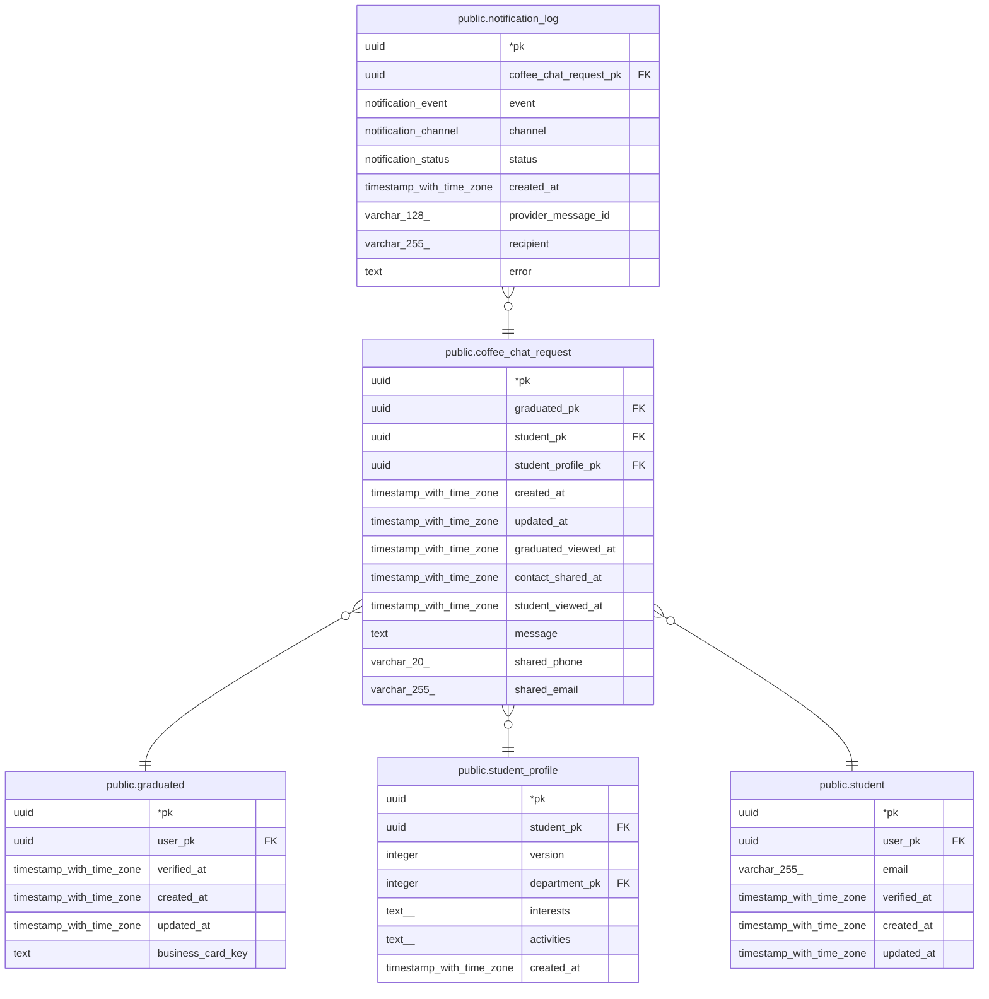

# public.coffee_chat_request

## Description

커피챗 요청. 같은 현업자에게 중복 요청 가능. 진행 단계(현업자 확인 → 연락처 공유 → 재학생 확인)는 처음 했을 때 시각만 기록

## Columns

| Name | Type | Default | Nullable | Children | Parents | Comment |
| ---- | ---- | ------- | -------- | -------- | ------- | ------- |
| pk | uuid |  | false | [public.notification_log](public.notification_log.md) |  |  |
| graduated_pk | uuid |  | false |  | [public.graduated](public.graduated.md) |  |
| student_pk | uuid |  | false |  | [public.student_profile](public.student_profile.md) [public.student](public.student.md) |  |
| student_profile_pk | uuid |  | false |  | [public.student_profile](public.student_profile.md) | 요청 당시의 재학생 정보 버전. 다른 학생의 버전이 들어가지 않도록 student_pk와 복합 FK |
| created_at | timestamp with time zone | now() | false |  |  |  |
| updated_at | timestamp with time zone | now() | false |  |  |  |
| graduated_viewed_at | timestamp with time zone |  | true |  |  |  |
| contact_shared_at | timestamp with time zone |  | true |  |  |  |
| student_viewed_at | timestamp with time zone |  | true |  |  |  |
| message | text |  | true |  |  |  |
| shared_phone | varchar(20) |  | true |  |  | 공유 시점 현업자 연락처 |
| shared_email | varchar(255) |  | true |  |  | 공유 시점 현업자 연락처 |

## Constraints

| Name | Type | Definition |
| ---- | ---- | ---------- |
| coffee_chat_request_pkey | PRIMARY KEY | PRIMARY KEY (pk) |
| coffee_chat_request_graduated_pk_graduated_pk_fk | FOREIGN KEY | FOREIGN KEY (graduated_pk) REFERENCES graduated(pk) |
| coffee_chat_request_student_profile_fk | FOREIGN KEY | FOREIGN KEY (student_profile_pk, student_pk) REFERENCES student_profile(pk, student_pk) |
| coffee_chat_request_student_pk_student_pk_fk | FOREIGN KEY | FOREIGN KEY (student_pk) REFERENCES student(pk) |

## Indexes

| Name | Definition |
| ---- | ---------- |
| coffee_chat_request_pkey | CREATE UNIQUE INDEX coffee_chat_request_pkey ON public.coffee_chat_request USING btree (pk) |
| coffee_chat_request_graduated_pk_index | CREATE INDEX coffee_chat_request_graduated_pk_index ON public.coffee_chat_request USING btree (graduated_pk) |
| coffee_chat_request_student_pk_index | CREATE INDEX coffee_chat_request_student_pk_index ON public.coffee_chat_request USING btree (student_pk) |

## Relations

---

> Generated by [tbls](https://github.com/k1LoW/tbls)
