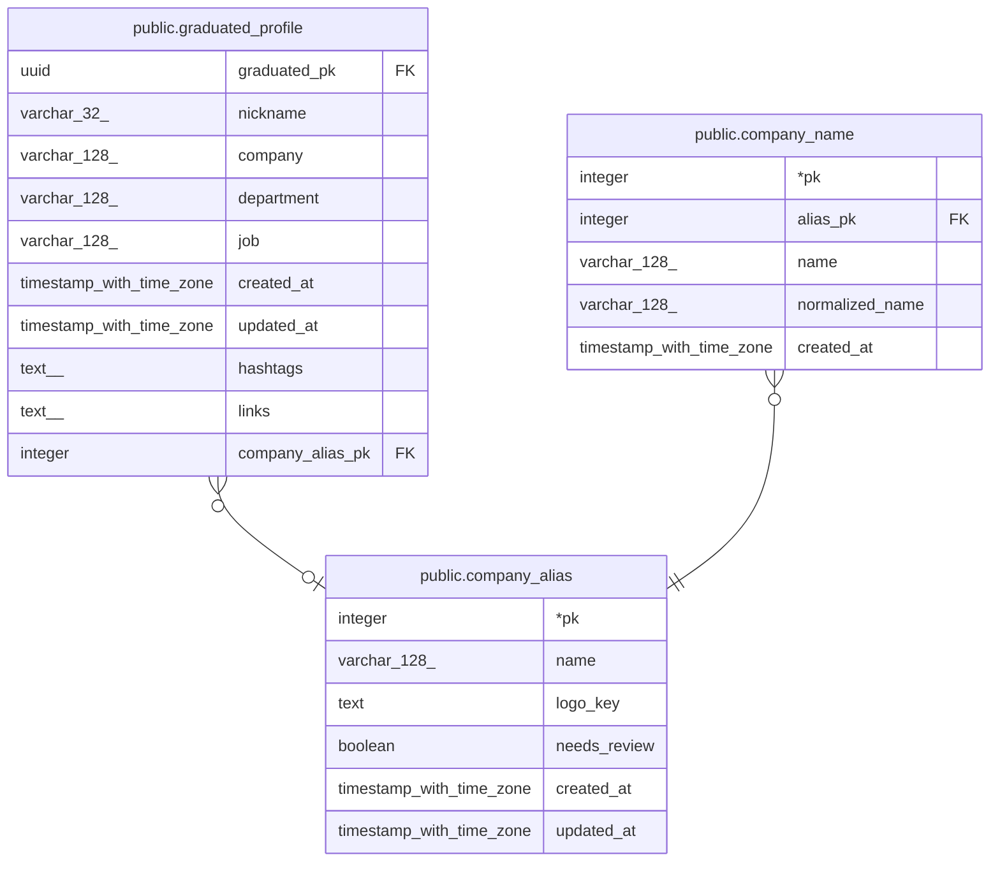

# public.company_alias

## Description

회사 (공식 이름). 현업자 목록 등 화면에는 이 이름과 로고가 나가며, 사람마다 다른 표기는 company_name에 묶임

## Columns

| Name | Type | Default | Nullable | Children | Parents | Comment |
| ---- | ---- | ------- | -------- | -------- | ------- | ------- |
| pk | integer |  | false | [public.graduated_profile](public.graduated_profile.md) [public.company_name](public.company_name.md) |  |  |
| name | varchar(128) |  | false |  |  |  |
| logo_key | text |  | true |  |  | 회사 로고 S3 object key (비공개 버킷, presigned URL로 접근) |
| needs_review | boolean | false | false |  |  | 현업자가 등록되지 않은 이름을 입력해 생긴 회사. 어드민이 승인하거나 다른 회사에 병합 |
| created_at | timestamp with time zone | now() | false |  |  |  |
| updated_at | timestamp with time zone | now() | false |  |  |  |

## Constraints

| Name | Type | Definition |
| ---- | ---- | ---------- |
| company_alias_pkey | PRIMARY KEY | PRIMARY KEY (pk) |
| company_alias_name_unique | UNIQUE | UNIQUE (name) |

## Indexes

| Name | Definition |
| ---- | ---------- |
| company_alias_pkey | CREATE UNIQUE INDEX company_alias_pkey ON public.company_alias USING btree (pk) |
| company_alias_name_unique | CREATE UNIQUE INDEX company_alias_name_unique ON public.company_alias USING btree (name) |

## Relations

---

> Generated by [tbls](https://github.com/k1LoW/tbls)
