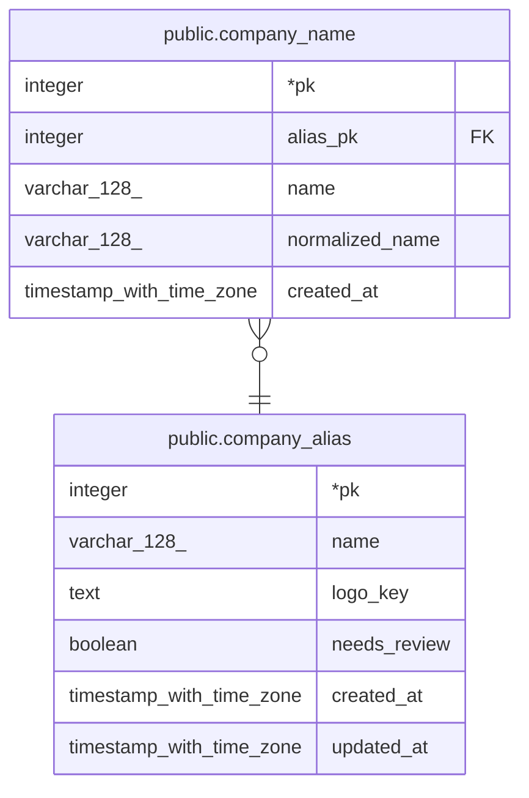

# public.company_name

## Description

회사 이름 표기. 회사 검색은 이 테이블만 봄 (회사 이름도 여기에 들어 있음). 한 표기는 한 회사에만 속함

## Columns

| Name | Type | Default | Nullable | Children | Parents | Comment |
| ---- | ---- | ------- | -------- | -------- | ------- | ------- |
| pk | integer |  | false |  |  |  |
| alias_pk | integer |  | false |  | [public.company_alias](public.company_alias.md) |  |
| name | varchar(128) |  | false |  |  | 입력된 원문 |
| normalized_name | varchar(128) |  | false |  |  | 앞뒤 공백 제거 · 연속 공백 하나로 · 소문자 (normalizeCompanyName). 검색 · 중복 판단용 |
| created_at | timestamp with time zone | now() | false |  |  |  |

## Constraints

| Name | Type | Definition |
| ---- | ---- | ---------- |
| company_name_alias_pk_company_alias_pk_fk | FOREIGN KEY | FOREIGN KEY (alias_pk) REFERENCES company_alias(pk) |
| company_name_pkey | PRIMARY KEY | PRIMARY KEY (pk) |
| company_name_normalized_name_unique | UNIQUE | UNIQUE (normalized_name) |

## Indexes

| Name | Definition |
| ---- | ---------- |
| company_name_pkey | CREATE UNIQUE INDEX company_name_pkey ON public.company_name USING btree (pk) |
| company_name_normalized_name_unique | CREATE UNIQUE INDEX company_name_normalized_name_unique ON public.company_name USING btree (normalized_name) |
| company_name_alias_pk_index | CREATE INDEX company_name_alias_pk_index ON public.company_name USING btree (alias_pk) |
| company_name_normalized_name_trgm_idx | CREATE INDEX company_name_normalized_name_trgm_idx ON public.company_name USING gin (normalized_name gin_trgm_ops) |

## Relations

---

> Generated by [tbls](https://github.com/k1LoW/tbls)
