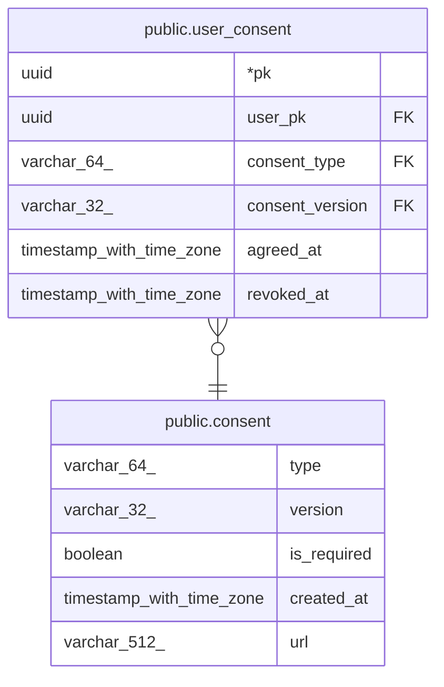

# public.consent

## Description

약관 버전 기준 데이터. 새 버전은 행을 수정하지 말고 새 마이그레이션으로 추가

## Columns

| Name | Type | Default | Nullable | Children | Parents | Comment |
| ---- | ---- | ------- | -------- | -------- | ------- | ------- |
| type | varchar(64) |  | false | [public.user_consent](public.user_consent.md) |  |  |
| version | varchar(32) |  | false | [public.user_consent](public.user_consent.md) |  |  |
| is_required | boolean |  | false |  |  | 필수 약관 여부. 필수 약관은 철회할 수 없음 |
| created_at | timestamp with time zone | now() | false |  |  |  |
| url | varchar(512) |  | false |  |  |  |

## Constraints

| Name | Type | Definition |
| ---- | ---- | ---------- |
| consent_type_version_pk | PRIMARY KEY | PRIMARY KEY (type, version) |

## Indexes

| Name | Definition |
| ---- | ---------- |
| consent_type_version_pk | CREATE UNIQUE INDEX consent_type_version_pk ON public.consent USING btree (type, version) |

## Relations

---

> Generated by [tbls](https://github.com/k1LoW/tbls)
