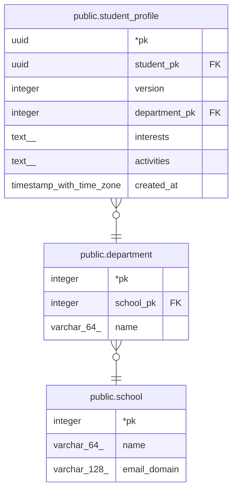

# public.department

## Description

학과 기준 데이터. 학과명이 바뀌면 같은 행의 name만 수정 (버전 관리 안 함)

## Columns

| Name | Type | Default | Nullable | Children | Parents | Comment |
| ---- | ---- | ------- | -------- | -------- | ------- | ------- |
| pk | integer |  | false | [public.student_profile](public.student_profile.md) |  |  |
| school_pk | integer |  | false |  | [public.school](public.school.md) |  |
| name | varchar(64) |  | false |  |  |  |

## Constraints

| Name | Type | Definition |
| ---- | ---- | ---------- |
| department_pkey | PRIMARY KEY | PRIMARY KEY (pk) |
| department_school_pk_name_unique | UNIQUE | UNIQUE (school_pk, name) |
| department_school_pk_school_pk_fk | FOREIGN KEY | FOREIGN KEY (school_pk) REFERENCES school(pk) |

## Indexes

| Name | Definition |
| ---- | ---------- |
| department_pkey | CREATE UNIQUE INDEX department_pkey ON public.department USING btree (pk) |
| department_school_pk_name_unique | CREATE UNIQUE INDEX department_school_pk_name_unique ON public.department USING btree (school_pk, name) |

## Relations

---

> Generated by [tbls](https://github.com/k1LoW/tbls)
