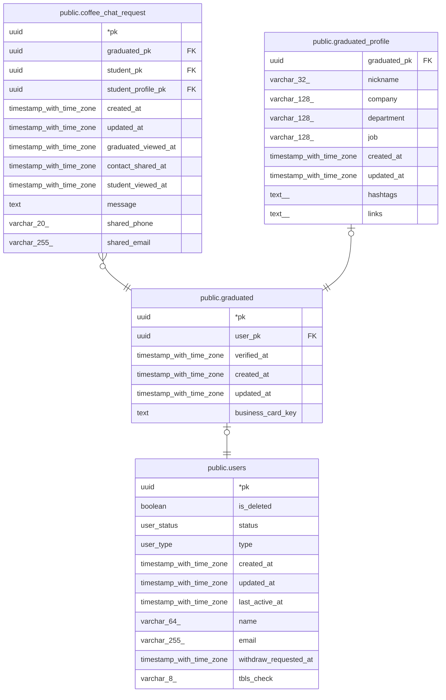

# public.graduated

## Description

현업자

## Columns

| Name | Type | Default | Nullable | Children | Parents | Comment |
| ---- | ---- | ------- | -------- | -------- | ------- | ------- |
| pk | uuid |  | false | [public.coffee_chat_request](public.coffee_chat_request.md) [public.graduated_profile](public.graduated_profile.md) |  |  |
| user_pk | uuid |  | false |  | [public.users](public.users.md) |  |
| verified_at | timestamp with time zone |  | true |  |  |  |
| created_at | timestamp with time zone | now() | false |  |  |  |
| updated_at | timestamp with time zone | now() | false |  |  |  |
| business_card_key | text |  | true |  |  | 명함 사진 S3 object key (비공개 버킷, presigned URL로 접근) |

## Constraints

| Name | Type | Definition |
| ---- | ---- | ---------- |
| graduated_pkey | PRIMARY KEY | PRIMARY KEY (pk) |
| graduated_user_pk_unique | UNIQUE | UNIQUE (user_pk) |
| graduated_user_pk_users_pk_fk | FOREIGN KEY | FOREIGN KEY (user_pk) REFERENCES users(pk) |

## Indexes

| Name | Definition |
| ---- | ---------- |
| graduated_pkey | CREATE UNIQUE INDEX graduated_pkey ON public.graduated USING btree (pk) |
| graduated_user_pk_unique | CREATE UNIQUE INDEX graduated_user_pk_unique ON public.graduated USING btree (user_pk) |

## Relations

---

> Generated by [tbls](https://github.com/k1LoW/tbls)
