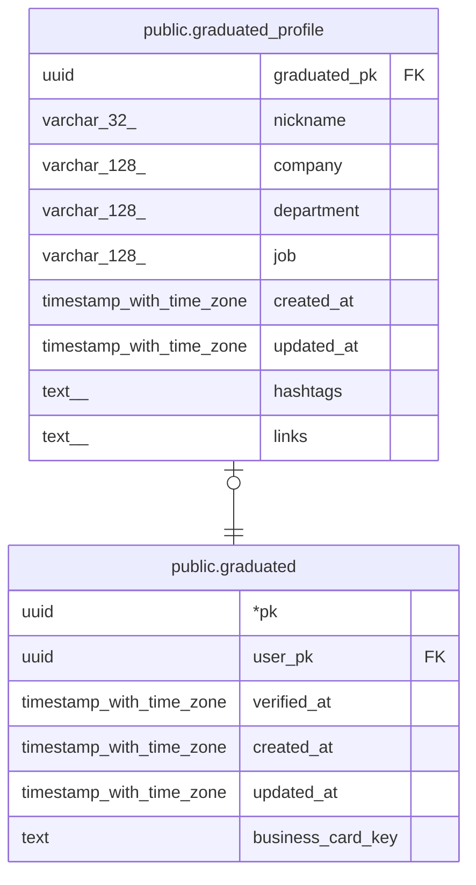

# public.graduated_profile

## Description

현업자 추가 정보. 알림 수단 · 공유할 연락처는 coffee_chat_contact

## Columns

| Name | Type | Default | Nullable | Children | Parents | Comment |
| ---- | ---- | ------- | -------- | -------- | ------- | ------- |
| graduated_pk | uuid |  | false |  | [public.graduated](public.graduated.md) |  |
| nickname | varchar(32) |  | false |  |  | 가입 후 수정 불가 |
| company | varchar(128) |  | false |  |  |  |
| department | varchar(128) |  | false |  |  | 회사 부서 (비공개) |
| job | varchar(128) |  | false |  |  | 직무 |
| created_at | timestamp with time zone | now() | false |  |  |  |
| updated_at | timestamp with time zone | now() | false |  |  |  |
| hashtags | text[] |  | true |  |  | 마이페이지에서 선택 입력 |
| links | text[] |  | true |  |  | 마이페이지에서 선택 입력 |

## Constraints

| Name | Type | Definition |
| ---- | ---- | ---------- |
| graduated_profile_pkey | PRIMARY KEY | PRIMARY KEY (graduated_pk) |
| graduated_profile_graduated_pk_graduated_pk_fk | FOREIGN KEY | FOREIGN KEY (graduated_pk) REFERENCES graduated(pk) |

## Indexes

| Name | Definition |
| ---- | ---------- |
| graduated_profile_pkey | CREATE UNIQUE INDEX graduated_profile_pkey ON public.graduated_profile USING btree (graduated_pk) |

## Relations

---

> Generated by [tbls](https://github.com/k1LoW/tbls)
