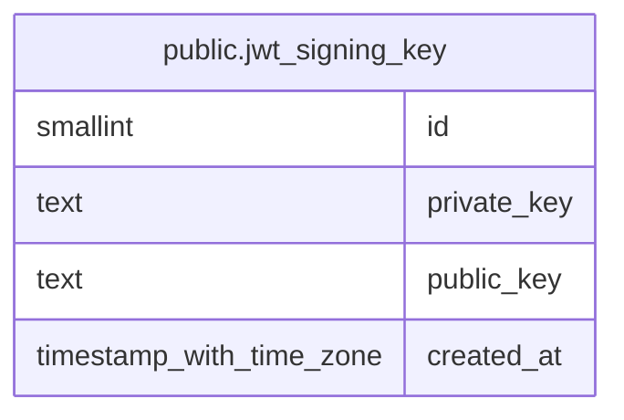

# public.jwt_signing_key

## Description

서버 전체에서 하나인 JWT 서명 키. replica가 각자 다른 키를 넣지 못하도록 행을 1개로 제한

## Columns

| Name | Type | Default | Nullable | Children | Parents | Comment |
| ---- | ---- | ------- | -------- | -------- | ------- | ------- |
| id | smallint | 1 | false |  |  |  |
| private_key | text |  | false |  |  | 평문이라 DB가 유출되면 access token을 위조할 수 있음 |
| public_key | text |  | false |  |  |  |
| created_at | timestamp with time zone | now() | false |  |  |  |

## Constraints

| Name | Type | Definition |
| ---- | ---- | ---------- |
| jwt_signing_key_singleton | CHECK | CHECK ((id = 1)) |
| jwt_signing_key_pkey | PRIMARY KEY | PRIMARY KEY (id) |

## Indexes

| Name | Definition |
| ---- | ---------- |
| jwt_signing_key_pkey | CREATE UNIQUE INDEX jwt_signing_key_pkey ON public.jwt_signing_key USING btree (id) |

## Relations

---

> Generated by [tbls](https://github.com/k1LoW/tbls)
