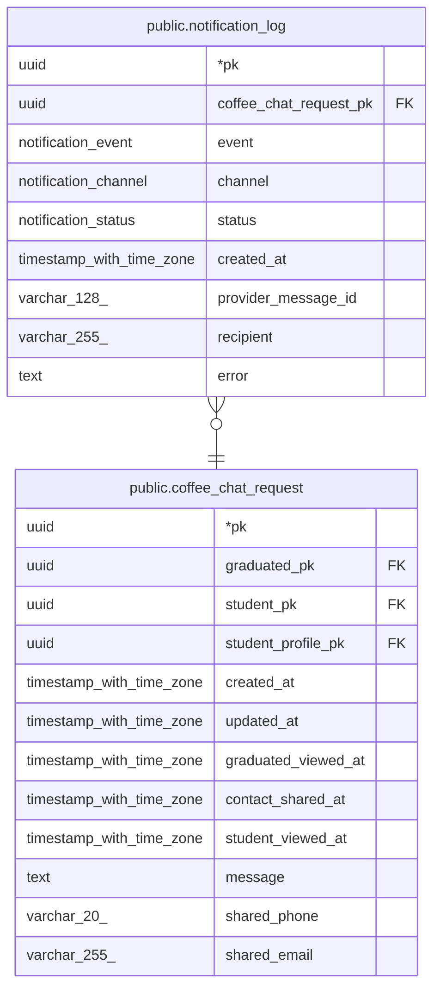

# public.notification_log

## Description

이메일 · 카카오 알림톡 전송 로그 (channel로 구분). insert만 함, 재시도도 새 행

## Columns

| Name | Type | Default | Nullable | Children | Parents | Comment |
| ---- | ---- | ------- | -------- | -------- | ------- | ------- |
| pk | uuid |  | false |  |  |  |
| coffee_chat_request_pk | uuid |  | false |  | [public.coffee_chat_request](public.coffee_chat_request.md) |  |
| event | notification_event |  | false |  |  |  |
| channel | notification_channel |  | false |  |  |  |
| status | notification_status |  | false |  |  |  |
| created_at | timestamp with time zone | now() | false |  |  |  |
| provider_message_id | varchar(128) |  | true |  |  |  |
| recipient | varchar(255) |  | false |  |  | 이메일 주소 또는 전화번호 |
| error | text |  | true |  |  |  |

## Constraints

| Name | Type | Definition |
| ---- | ---- | ---------- |
| notification_log_coffee_chat_request_pk_coffee_chat_request_pk_ | FOREIGN KEY | FOREIGN KEY (coffee_chat_request_pk) REFERENCES coffee_chat_request(pk) |
| notification_log_pkey | PRIMARY KEY | PRIMARY KEY (pk) |

## Indexes

| Name | Definition |
| ---- | ---------- |
| notification_log_pkey | CREATE UNIQUE INDEX notification_log_pkey ON public.notification_log USING btree (pk) |
| notification_log_coffee_chat_request_pk_index | CREATE INDEX notification_log_coffee_chat_request_pk_index ON public.notification_log USING btree (coffee_chat_request_pk) |

## Relations

---

> Generated by [tbls](https://github.com/k1LoW/tbls)
