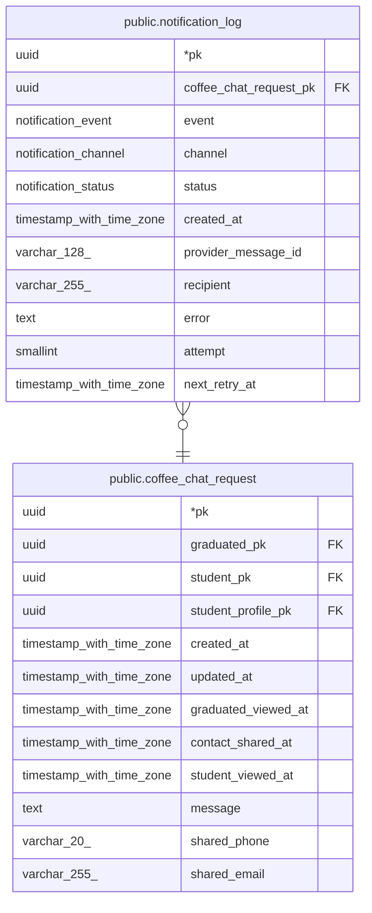

# public.notification_log

## Description

이메일 · 카카오 알림톡 전송 로그 (channel로 구분). 시도마다 새 행. 실패한 행에 next_retry_at이 있으면 재시도 스케줄러가 처리하고 비움 (CRB-75)

## Columns

| Name | Type | Default | Nullable | Children | Parents | Comment |
| ---- | ---- | ------- | -------- | -------- | ------- | ------- |
| pk | uuid |  | false |  |  |  |
| coffee_chat_request_pk | uuid |  | false |  | [public.coffee_chat_request](public.coffee_chat_request.md) |  |
| event | notification_event |  | false |  |  |  |
| channel | notification_channel |  | false |  |  |  |
| status | notification_status |  | false |  |  |  |
| created_at | timestamp with time zone | now() | false |  |  |  |
| provider_message_id | varchar(128) |  | true |  |  |  |
| recipient | varchar(255) |  | false |  |  | 이메일 주소 또는 전화번호 |
| error | text |  | true |  |  |  |
| attempt | smallint | 1 | false |  |  | 몇 번째 발송 시도인지 (1 = 처음 발송, 최대 4) |
| next_retry_at | timestamp with time zone |  | true |  |  | 이 실패를 다시 보낼 시각. null이면 재시도 대상이 아님 (성공 · 마지막 시도 · 이미 재시도함) |

## Constraints

| Name | Type | Definition |
| ---- | ---- | ---------- |
| notification_log_coffee_chat_request_pk_coffee_chat_request_pk_ | FOREIGN KEY | FOREIGN KEY (coffee_chat_request_pk) REFERENCES coffee_chat_request(pk) |
| notification_log_pkey | PRIMARY KEY | PRIMARY KEY (pk) |

## Indexes

| Name | Definition |
| ---- | ---------- |
| notification_log_pkey | CREATE UNIQUE INDEX notification_log_pkey ON public.notification_log USING btree (pk) |
| notification_log_coffee_chat_request_pk_index | CREATE INDEX notification_log_coffee_chat_request_pk_index ON public.notification_log USING btree (coffee_chat_request_pk) |
| notification_log_next_retry_at_idx | CREATE INDEX notification_log_next_retry_at_idx ON public.notification_log USING btree (next_retry_at) WHERE (next_retry_at IS NOT NULL) |

## Relations

---

> Generated by [tbls](https://github.com/k1LoW/tbls)
