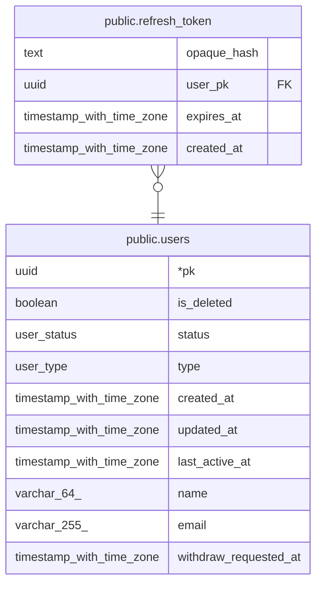

# public.refresh_token

## Description

리프레시 토큰. rotation 시 새 행 insert + 기존 행 delete

## Columns

| Name | Type | Default | Nullable | Children | Parents | Comment |
| ---- | ---- | ------- | -------- | -------- | ------- | ------- |
| opaque_hash | text |  | false |  |  | 토큰 해시. 원문은 저장하지 않음 |
| user_pk | uuid |  | false |  | [public.users](public.users.md) |  |
| expires_at | timestamp with time zone |  | false |  |  |  |
| created_at | timestamp with time zone | now() | false |  |  |  |

## Constraints

| Name | Type | Definition |
| ---- | ---- | ---------- |
| refresh_token_pkey | PRIMARY KEY | PRIMARY KEY (opaque_hash) |
| refresh_token_user_pk_users_pk_fk | FOREIGN KEY | FOREIGN KEY (user_pk) REFERENCES users(pk) |

## Indexes

| Name | Definition |
| ---- | ---------- |
| refresh_token_pkey | CREATE UNIQUE INDEX refresh_token_pkey ON public.refresh_token USING btree (opaque_hash) |
| refresh_token_user_pk_index | CREATE INDEX refresh_token_user_pk_index ON public.refresh_token USING btree (user_pk) |

## Relations

---

> Generated by [tbls](https://github.com/k1LoW/tbls)
