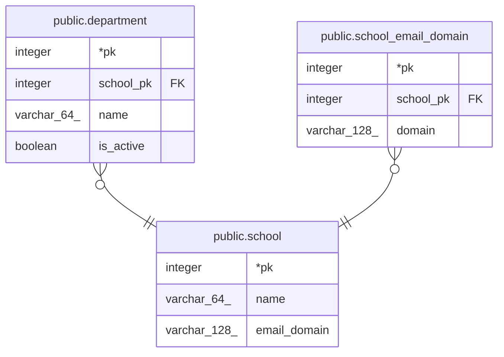

# public.school

## Description

학교 기준 데이터 (seed로 pk를 고정해서 넣음)

## Columns

| Name | Type | Default | Nullable | Children | Parents | Comment |
| ---- | ---- | ------- | -------- | -------- | ------- | ------- |
| pk | integer |  | false | [public.department](public.department.md) [public.school_email_domain](public.school_email_domain.md) |  |  |
| name | varchar(64) |  | false |  |  |  |
| email_domain | varchar(128) |  | true |  |  | 쓰지 않음 (school_email_domain으로 옮김). 배포 중 이전 버전 pod가 읽으므로 남겨 두고 다음 릴리스에서 지움 |

## Constraints

| Name | Type | Definition |
| ---- | ---- | ---------- |
| school_pkey | PRIMARY KEY | PRIMARY KEY (pk) |
| school_email_domain_unique | UNIQUE | UNIQUE (email_domain) |

## Indexes

| Name | Definition |
| ---- | ---------- |
| school_pkey | CREATE UNIQUE INDEX school_pkey ON public.school USING btree (pk) |
| school_email_domain_unique | CREATE UNIQUE INDEX school_email_domain_unique ON public.school USING btree (email_domain) |

## Relations

---

> Generated by [tbls](https://github.com/k1LoW/tbls)
