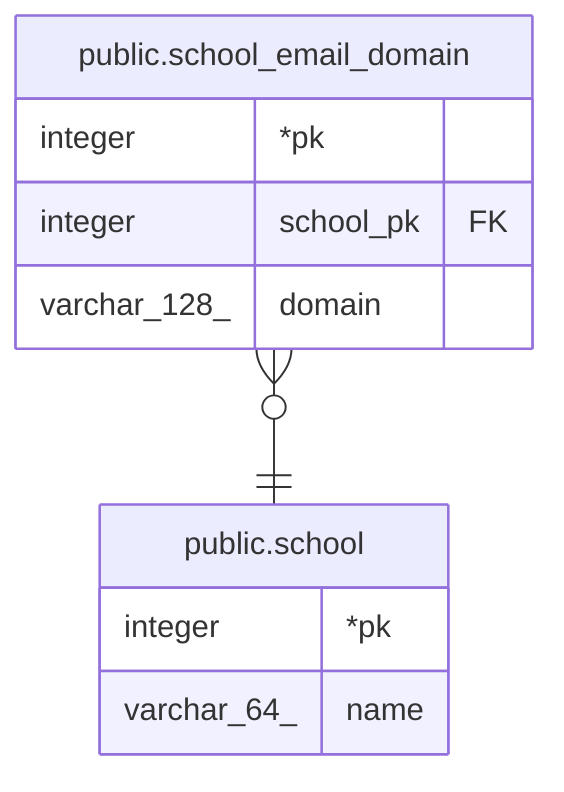

# public.school_email_domain

## Description

학교 이메일 인증 시 허용 도메인. 재학생의 학교를 정하는 기준이라 한 도메인은 한 학교에만 속함. 변경은 superadmin만 할 수 있음

## Columns

| Name | Type | Default | Nullable | Children | Parents | Comment |
| ---- | ---- | ------- | -------- | -------- | ------- | ------- |
| pk | integer |  | false |  |  |  |
| school_pk | integer |  | false |  | [public.school](public.school.md) |  |
| domain | varchar(128) |  | false |  |  | 소문자로 저장 |

## Constraints

| Name | Type | Definition |
| ---- | ---- | ---------- |
| school_email_domain_school_pk_school_pk_fk | FOREIGN KEY | FOREIGN KEY (school_pk) REFERENCES school(pk) |
| school_email_domain_pkey | PRIMARY KEY | PRIMARY KEY (pk) |
| school_email_domain_domain_unique | UNIQUE | UNIQUE (domain) |

## Indexes

| Name | Definition |
| ---- | ---------- |
| school_email_domain_pkey | CREATE UNIQUE INDEX school_email_domain_pkey ON public.school_email_domain USING btree (pk) |
| school_email_domain_domain_unique | CREATE UNIQUE INDEX school_email_domain_domain_unique ON public.school_email_domain USING btree (domain) |

## Relations

---

> Generated by [tbls](https://github.com/k1LoW/tbls)
