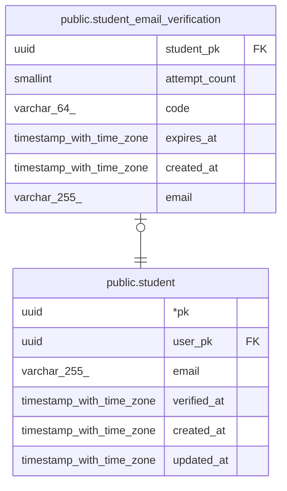

# public.student_email_verification

## Description

진행 중인 학교 이메일 인증. 학생당 1개, 재요청 시 upsert, 인증 성공 시 행 삭제

## Columns

| Name | Type | Default | Nullable | Children | Parents | Comment |
| ---- | ---- | ------- | -------- | -------- | ------- | ------- |
| student_pk | uuid |  | false |  | [public.student](public.student.md) |  |
| attempt_count | smallint | 0 | false |  |  |  |
| code | varchar(64) |  | false |  |  | 인증번호의 HMAC-SHA256 (hex). 원문은 저장하지 않음 |
| expires_at | timestamp with time zone |  | false |  |  |  |
| created_at | timestamp with time zone | now() | false |  |  |  |
| email | varchar(255) |  | false |  |  |  |

## Constraints

| Name | Type | Definition |
| ---- | ---- | ---------- |
| student_email_verification_pkey | PRIMARY KEY | PRIMARY KEY (student_pk) |
| student_email_verification_student_pk_student_pk_fk | FOREIGN KEY | FOREIGN KEY (student_pk) REFERENCES student(pk) |

## Indexes

| Name | Definition |
| ---- | ---------- |
| student_email_verification_pkey | CREATE UNIQUE INDEX student_email_verification_pkey ON public.student_email_verification USING btree (student_pk) |

## Relations

---

> Generated by [tbls](https://github.com/k1LoW/tbls)
