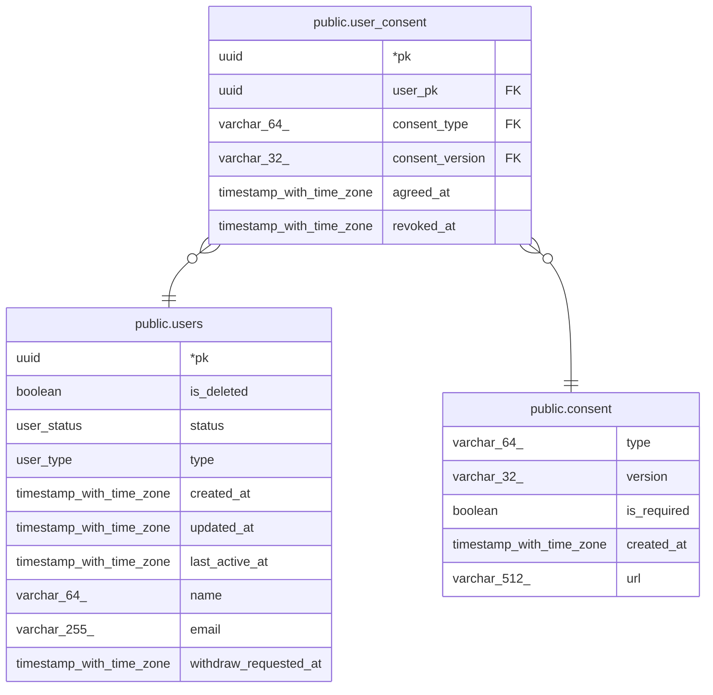

# public.user_consent

## Description

동의 이력. 철회하면 revoked_at 기록, 재동의는 새 행

## Columns

| Name | Type | Default | Nullable | Children | Parents | Comment |
| ---- | ---- | ------- | -------- | -------- | ------- | ------- |
| pk | uuid |  | false |  |  |  |
| user_pk | uuid |  | false |  | [public.users](public.users.md) |  |
| consent_type | varchar(64) |  | false |  | [public.consent](public.consent.md) |  |
| consent_version | varchar(32) |  | false |  | [public.consent](public.consent.md) |  |
| agreed_at | timestamp with time zone | now() | false |  |  |  |
| revoked_at | timestamp with time zone |  | true |  |  | null이면 유효한 동의. 유효한 동의는 약관 버전당 1개 |

## Constraints

| Name | Type | Definition |
| ---- | ---- | ---------- |
| user_consent_consent_fk | FOREIGN KEY | FOREIGN KEY (consent_type, consent_version) REFERENCES consent(type, version) |
| user_consent_pkey | PRIMARY KEY | PRIMARY KEY (pk) |
| user_consent_user_pk_users_pk_fk | FOREIGN KEY | FOREIGN KEY (user_pk) REFERENCES users(pk) |

## Indexes

| Name | Definition |
| ---- | ---------- |
| user_consent_pkey | CREATE UNIQUE INDEX user_consent_pkey ON public.user_consent USING btree (pk) |
| user_consent_active_unique | CREATE UNIQUE INDEX user_consent_active_unique ON public.user_consent USING btree (user_pk, consent_type, consent_version) WHERE (revoked_at IS NULL) |
| user_consent_user_pk_index | CREATE INDEX user_consent_user_pk_index ON public.user_consent USING btree (user_pk) |

## Relations

---

> Generated by [tbls](https://github.com/k1LoW/tbls)
